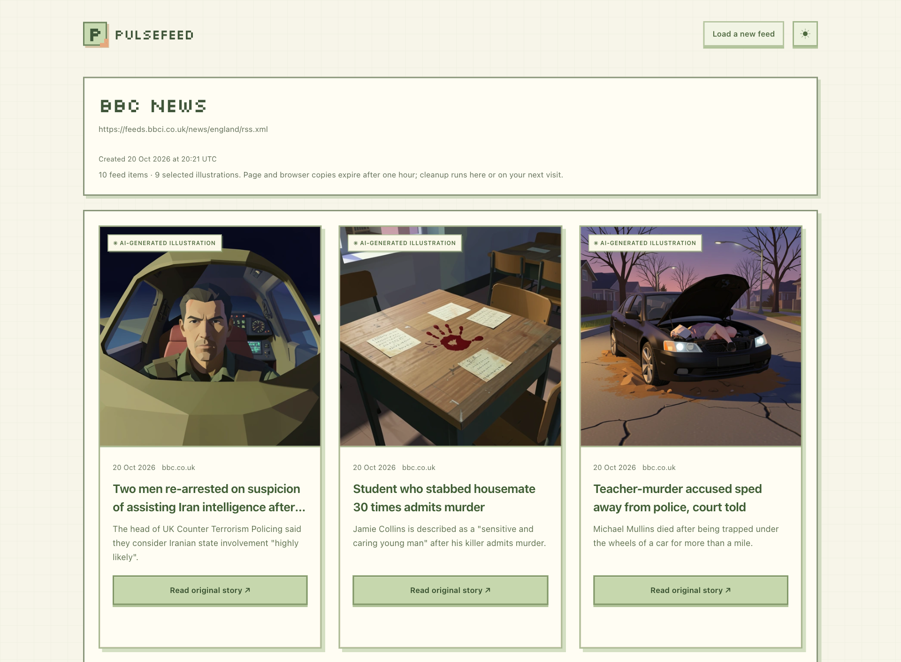

# PulseFeed

**An RSS reader that turns RSS stories into illustrated cards.**

Paste a public RSS or Atom URL and click **View RSS**. Qwen uses the title and available feed excerpt to write a visual prompt; FLUX makes the image. You get a private reader page for an hour, with the original text, source links and clearly labeled AI illustrations.

The reader is small. Most of the work is in making the model pipeline predictable: deciding what can run, tracking accepted jobs, recovering from uncertain submissions and making sure a refresh never generates another image.



The setup is one Railway app and two separate Runpod queue endpoints. I tested the full public Railway flow with nine NYTimes stories, as well as the laptop-to-Runpod path and native workers on a DGX Spark. [Architecture and tradeoffs](docs/architecture.md) · [Local versus cloud](docs/diagrams/local-vs-cloud.svg)

## Take a look

| Start with | What it covers |
| --- | --- |
| [Reviewer guide](docs/reviewer-guide.md) | A short route through the demo, admin and source |
| [Six-page case study](output/pdf/pulsefeed-review.pdf) · [editable Word copy](output/docx/pulsefeed-review.docx) | Architecture, reader and admin screenshots, each worker, troubleshooting and next steps |
| [Review pack](output/pulsefeed-review-pack.zip) | The case study, editable document, one-page summary and diagrams |
| [Architecture](docs/architecture.md) | Request flow, admission, failure recovery and storage boundaries |
| [Code walkthrough](docs/code-walkthrough.md) | Follow an RSS submission through the source |
| [Request lifecycle diagram](docs/diagrams/request-lifecycle.svg) | From the first click to a saved browser image |
| [All guides](docs/README.md) | Setup, deployment, operations and evidence |

## Run the demo

Use Python 3.11 and run these commands from the repository root. This mode uses a synthetic feed and synthetic model results; it needs no GPU or provider credentials.

```sh
python3.11 -m venv app/.venv
app/.venv/bin/python -m pip install -c app/requirements.lock -e 'app[test]'
export DATABASE_PATH="$PWD/app/demo.db"
export APP_BASE_URL=http://127.0.0.1:8000
export SESSION_SECRET="$(python3.11 -c 'import secrets; print(secrets.token_urlsafe(48))')"
export PULSEFEED_FAKE_MODE=true
export COOKIE_SECURE=false
export PUBLIC_ACCESS_ENABLED=true
app/.venv/bin/python -m uvicorn pulsefeed.main:create_app --factory \
  --host 127.0.0.1 --port 8000 --workers 1 --no-access-log
```

Open [localhost:8000](http://127.0.0.1:8000/), enter `demo` and click **View RSS**. Keep this database separate from real-provider runs. See the [app guide](app/README.md) for admin access and provider configuration, or the [Spark guide](local/README.md) to run the real models.

## What is working

The [Railway web app](https://pulsefeed-web-production.up.railway.app) has persistent SQLite, secure sessions and admin sign-in. Its full NYTimes test completed **nine 512-square images from eighteen successful model calls**, with no retries. Admin usage and quota counters matched; refresh and exact request replay made no extra calls. [Production validation](docs/production-validation-2026-10-20.md) · [Release status](docs/release-status.md)

The controlled **local app → live Runpod** test produced **ten 512-square images from twenty successful model calls**, with no retries or duplicate invocations. Three requests per model and six started stories were observed. Qwen reported 4,880 input and 767 output tokens; admin totals matched the saved results. The [validation record](docs/local-runpod-validation-2026-10-20.md) separates provider wait time from execution time. Cold workers were the main delay, so this is not a snappy warm-latency benchmark.

Earlier native Spark validation covered Hacker News, BBC England and NYTimes: 27 images and 54 successful model calls, with zero retries. Both model images are public on [Docker Hub](https://hub.docker.com/r/rokkovach/pulsefeed/tags). Use the current tags and immutable digests in the [release status](docs/release-status.md); known-working versions are retained for rollback.

Qwen v1.0.6 contains the patched CA bundle, and its rollout passed a fresh Runpod request before Railway generation was enabled. The app and FLUX also pin the corrected bundle. Some upstream OS/native dependency findings remain, including bundled FFmpeg. The [remediation record](docs/dependency-remediation-2026-10-20.md) describes their scope. The project is a bounded case-study deployment, not a claim of complete vulnerability clearance.

## A few deliberate constraints

- **Two model workers.** Qwen runs `nvidia/Qwen3-8B-NVFP4`; FLUX runs `black-forest-labs/FLUX.2-klein-4B`. Each has its own image and dependency stack. The app coordinates them; neither worker calls the other.
- **One explicit click admits work.** The app snapshots a source-order prefix, reserves capacity and saves the request key. Replaying that key, refreshing, polling or retrieving an image never admits more inference.
- **Uncertainty pauses dispatch.** If provider acceptance is unknown, the app holds reservations for reconciliation. It does not guess that the job failed and submit it again. A cancellation acknowledgement alone does not prove GPU work stopped.
- **Temporary reader, temporary images.** Pages are visitor-scoped and expire one hour after creation. SQLite keeps state and metadata; images live in temporary provider results and expiring browser Blobs. Runpod's 30-minute result window can leave a late visitor without an image if no browser copy was saved.
- **Small, bounded deployment.** One app replica, one ASGI process and one coordinator share persistent SQLite. Defaults are 100 FLUX attempts/day, 30 story starts/rolling hour and ten stories/new page. Saved admin policy is authoritative after initialization; each selected story reserves two FLUX attempts for its bounded retry budget.

There is no signup, saved-feed library or permanent server image archive. Anonymous visitor limits are browser-session limits; the global allowance bounds shared inference. Public deployment requires HTTPS and secure cookies. Keep secrets, private environment files, SQLite databases and credential URLs out of shared output.

## Repository

| Path | Responsibility |
| --- | --- |
| [`app/`](app/README.md) | FastAPI/Jinja reader, sessions, feed retrieval, SQLite and coordinator |
| [`workers/qwen/`](workers/qwen/README.md) | Prompt generation, model validation and worker lifecycle |
| [`workers/flux/`](workers/flux/README.md) | Image generation, bounded encoding and worker lifecycle |
| [`contracts/`](contracts/README.md) | Versioned job schemas and synthetic fixtures |
| [`local/`](local/README.md) | Spark containers, authenticated gateways and laptop launcher |
| [`integration/`](integration/README.md) | Cross-component checks and dated validation |
| [`docs/`](docs/README.md) | Explanations, diagrams, deployment and operations |
| [`PRD/`](PRD/README.md) | Original briefs and design contracts |

For verification, start with the [integration guide](integration/README.md). App and CPU checks use Python 3.11; browser behavior harnesses use Node 18+. Keep the worker runtimes in their separate environments.

## Before sharing or publishing

Local secrets, credentials, certificates, cookies, databases, downloaded weights and raw test artifacts are ignored. The review ZIP uses an explicit file allowlist. Stage the intended files and run `python3 scripts/check-release.py` before committing; it checks staged content, common credential patterns and nested document/archive contents. See [security boundaries](SECURITY.md). Never include the admin password in a screenshot, report or repository.
