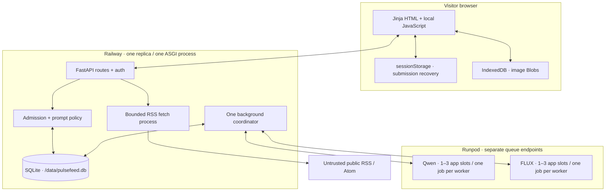

# Architecture

PulseFeed separates a small stateful web app from two independently packaged GPU workers. The app owns admission, authorization, prompt composition and accounting. Workers validate fixed versioned jobs and perform one model stage; neither worker calls the other.

## Runtime topology



On Spark, replace Runpod with two authenticated loopback HTTP gateways reached through SSH. The laptop still runs the same app/coordinator. The ARM64 profiles use a shared file lock to serialize actual GPU inference while both models stay resident. App request overlap is distinct from simultaneous GPU execution. [Spark topology](../local/README.md)

## One explicit View RSS request

```mermaid
sequenceDiagram
    participant B as Browser
    participant A as App
    participant D as SQLite
    participant R as Public feed
    participant Q as Qwen queue
    participant F as FLUX queue
    B->>A: GET / · receive visitor session
    B->>B: Save request key in sessionStorage
    B->>A: POST /api/view-feed · cookie + CSRF + URL + key
    A->>D: Check existing owner/key replay
    alt Exact replay
        D-->>A: Original view, selection and expiry
    else Fresh request
        A->>R: Validate destination, fetch bounded RSS/Atom
        R-->>A: Source articles
        A->>D: Atomically save snapshot + reserve limits + admit runs
    end
    A-->>B: /feeds/{view_id} · immutable one-hour expiry
    A->>D: Persist invocation before provider submission
    A->>Q: POST /run · fixed Qwen input
    Q-->>A: Job ID
    A->>D: Persist job ID
    loop Existing job polling
        A->>Q: GET /status/{id}
    end
    Q-->>A: output.result · prompt + measured usage
    A->>D: Record result, compose/filter final prompt
    A->>F: POST /run · fixed FLUX preset
    F-->>A: Job ID
    loop Existing job polling
        A->>F: GET /status/{id}
    end
    F-->>A: output.result · image + measured usage
    A->>D: Verify result, settle attempts, save metadata only
    B->>A: Poll owned batch and retrieve existing image
    A->>F: Retrieve existing result if needed
    A-->>B: Decoded/validated image bytes
    B->>B: Commit Blob to IndexedDB; display saved status
```

The browser stays on the form while feed validation runs. It navigates only after a validated response is saved locally. Reload does not silently re-submit an uncertain POST; the visitor explicitly retries the same key. A fresh key creates a fresh view even for the same URL. Read-only page/API requests never start model jobs.

## Admission and state

A single active global batch provides a small bounded queue. By default, `COORDINATOR_STAGE_CONCURRENCY=1` and `COORDINATOR_PIPELINE_SIZE=2` allow one job per model and two started unfinished stories. Set them to `3` and `6` for up to three Qwen and three FLUX requests; use a pipeline size of `1` for serial scheduling. Accepted jobs keep being polled after a limit reduction, even if they temporarily exceed the new cap. Qwen for later stories can overlap earlier FLUX jobs. Each started story has a 600-second default app deadline; queued stories receive their deadline when started. [Concurrency configuration and validation](model-concurrency.md)

```mermaid
stateDiagram-v2
    [*] --> queued: Atomic admission + reservations
    queued --> creating_prompt: Start Qwen stage
    creating_prompt --> generating_image: Verified prompt + filter
    generating_image --> completed: Verified image + settlement
    creating_prompt --> failed: Known terminal error
    generating_image --> failed: Known terminal error
    creating_prompt --> submission_unknown: Acceptance / execution uncertain
    generating_image --> submission_unknown: Acceptance / execution uncertain
    submission_unknown --> submission_unknown: Hold reservations; operator reconciliation
    completed --> [*]
    failed --> [*]
```



Invocation records separately track `prepared`, `submitting`, a known provider ID and observed terminal status. A crash between submitting and persisting the ID is an acceptance gap: the app cannot safely infer that nothing happened. It freezes new dispatch, keeps reservations and avoids automatic replay. Known accepted jobs remain eligible for status checks and cancellation. A provider `COMPLETED` state still requires `output.result.ok`; a handler's structured failure can be a successfully delivered provider job.

Default admission limits are additive:

| Scope | Default | Meaning |
| --- | --- | --- |
| Global daily | 100 | FLUX inference attempts, resetting at UTC midnight |
| Global rolling hour | 30 | Accepted per-story starts, even if Qwen later fails |
| Visitor rolling hour | 30 | FLUX attempt allowance |
| New reader page | 10 | Maximum selected source-order stories; configurable 1–10 |
| Visitor active views | 5 | Simultaneous unexpired reader pages |
| Visitor submissions | 5/minute | Mutation throttle, independent of inference accounting |

Each selected image reserves two FLUX attempts, including the one safe worker retry. Actual known attempts settle once; unknown outcomes stay conservatively reserved. The largest affordable source-order prefix is selected once, with no automatic backfill. Exact-key replay preserves selection and expiry. Admin edits affect future admissions; explicit allowance reset preserves model history, audit records and active/uncertain reservations. Environment policy values seed missing SQLite policy rather than replacing saved admin edits.

## Trust boundaries

| Boundary | Checks and ownership |
| --- | --- |
| Browser → app | Opaque visitor cookie backed by an HMAC-hashed SQLite session, CSRF for mutations, owner/unexpired-view membership, bounded JSON and rate limits |
| Public RSS → app | Public HTTP(S) destinations only, validated DNS pinned to the socket, redirect revalidation, 2 MiB response cap, safe XML parser; a bounded subprocess fetch has a 10-second deadline and four concurrent slots |
| Feed text → Qwen | Plain text normalization strips markup and script/style content; title ≤500 and display excerpt ≤4,000 Unicode code points; model title + excerpt ≤4,000 |
| Qwen → FLUX | Validate IDs/schema/model/output; compose a saved template, filter configured terms and apply a fixed fallback when needed |
| App → provider | Server-held API credential; static operator endpoint IDs; fixed schema, IDs, deadlines, model preset and bounded responses |
| Provider → app | Correlation checks, model identity, finite usage/counters, base64 size, image format/dimensions and actual decoding |
| Visitor → admin | `/admin` password exchange using `ADMIN_ACCESS_TOKEN`, signed login challenge and same-origin checks; bare display query flags grant no privilege |

Description selection prefers the first nonempty normalized `description`, then `summary`, `content` or RSS `content:encoded`. XHTML block boundaries become spaces. The resulting excerpt reaches the Qwen user message through `{{article_excerpt}}`; source text is data, separate from system instructions. The card displays at most three excerpt lines and omits an empty excerpt. A feed that only supplies “Comments” cannot provide missing article content; the app does not scrape linked articles.

Public access is anonymous and cookie-scoped, with no account management UI. Per-visitor limits do not establish a durable real-world identity: a new browser/session can create a new visitor. Global limits bound shared inference regardless. Proxy-derived IP limits are trustworthy only when `TRUSTED_PROXY_CIDRS` matches verified ingress hops.

## Storage and lifetimes

| Store | Contents | Lifetime / limitation |
| --- | --- | --- |
| Railway volume / SQLite | Sessions, policy, view membership/snapshots, frozen run inputs/settings, invocations, model usage, reservations and audit history | Persistent across app deployment; expired view snapshot payloads compact while idempotency tombstones and run/history records remain |
| Runpod result | Prompt or image in the native queue output | Async `/run` results retained 30 minutes after completion; TTL is a separate job lifespan |
| Spark gateway memory | Active jobs and terminal outputs | One hour after completion; bounded retained slots (default 128 per worker), no eviction of active/unexpired jobs; lost on restart |
| Browser sessionStorage | Bounded submission recovery record keyed by visitor | Ten minutes; reload requires explicit recovery action |
| Browser IndexedDB | Image Blobs keyed by visitor:view:run | Original immutable view expiry; purge expired entries before reuse and revoke object URLs |
| Model cache | Fixed revision weight snapshots | Persistent cache only; no generated image archive |

Runpod's 30-minute output window is shorter than a reader's hour. A saved browser Blob can cover the rest of the view, but another browser or a late return without a local copy may have no image to retrieve. The app reports unavailability without generating again. There is no permanent server image archive to hide this tradeoff. [Runpod result retention](https://docs.runpod.io/serverless/endpoints/endpoint-configurations#result-retention)

SQLite stores verified output metadata rather than image base64. It still contains sensitive article context, prompts and sessions; treat database backups as private. Usage reports expose aggregate model measurements separately for live/synthetic/unknown provenance, with missing measurements distinct from zero. They are operational evidence, not exact provider billing.

## Deliberate constraints

One process, one coordinator and one persistent database keep admission/recovery auditable, but are a single-instance design. Horizontal app scaling requires a shared database and explicit distributed coordinator ownership. Separate workers isolate incompatible inference stacks and scale independently, at the cost of two cold starts and potentially two billed GPU workers. Scale-to-zero reduces idle cost while introducing unmeasured cloud latency. See [deployment](deployment.md) and [operations](operations.md) for the remaining release gates.
