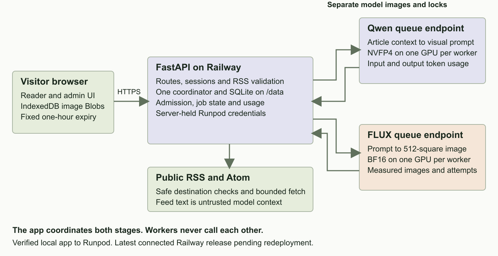
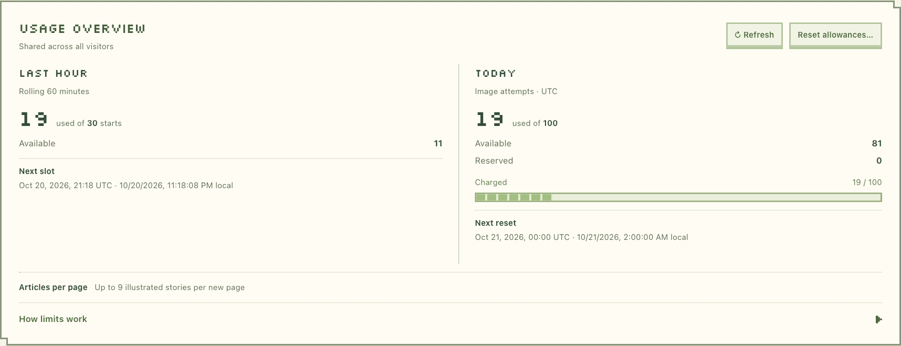
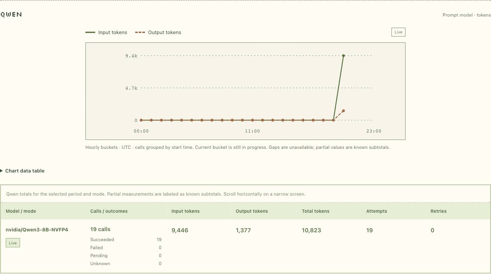

# PulseFeed Runpod case study

Rok Kovac · 20 October 2026

I built PulseFeed as a small RSS reader with an AI illustration pipeline. A visitor submits a public RSS or Atom URL, and two models turn the available article context into illustrated cards. The original text and source links remain visible, and every generated image is labeled as an AI illustration.

## Architecture

**The app.** FastAPI serves the reader and admin UI. One coordinator and persistent SQLite track sessions, page ownership, quotas, job IDs and aggregate usage. Railway hosts the web app; the latest version has also been tested from a laptop against the live Runpod endpoints.

**The workers.** Qwen writes a visual prompt from the article title and available description. The app composes and filters that prompt before submitting it to FLUX. Each model has its own Docker image, dependency lock and queue endpoint. Neither worker calls the other.

**The boundaries.** Provider keys stay on the server. The browser receives validated image bytes and saves Blobs in IndexedDB until the original one-hour page expiry. SQLite stores metadata, not image files. There is no permanent image archive.

The live Runpod pipeline is verified. The latest connected Railway generation flow and final dependency refresh remain release gates.

<!-- page -->

# The reader

A form is the starting point. Feed validation happens before navigation, so an invalid URL or malformed feed produces an error beside the input. A valid submission creates a private, visitor-scoped reading page with a fixed one-hour lifetime.

The cards show the publication date, linked source, title, a truncated description when available, and a clear action to read the original story. Missing descriptions fall back to title-only prompt context. The illustration style uses the low-detail 3D look of early-2000s games without requiring gaming subjects.

The page reveals after the first three images are decoded, or once work finishes if fewer are selected. Fixed image areas keep the layout steady while later images arrive. Light and dark themes, reduced-motion support and browser image reuse are included. Refreshing does not admit another generation request.

This screenshot uses the saved nine-story admin setting. Fresh databases default to ten stories per page; available shared allowance can reduce that selection.

<!-- page -->

# The admin view

The password-protected dashboard puts usage first. Prompt templates, content filters, generation limits and model reports expand separately. Each prompt section has its own save action; changes affect future runs while existing runs retain their original settings.

The hourly limit counts story starts. The daily limit counts image attempts, including reserved or unresolved work. Resetting spent allowance preserves active reservations and the model usage history. The page cap is configurable up to ten stories.

Qwen reports input and output tokens. FLUX has a separate images-versus-attempts report; it does not invent a token equivalent. Both support Today and All time. Aggregate reports exclude visitor feeds and article content. An authenticated admin can inspect model details beneath articles on their own reader page.

These screenshots include later exploratory use of the local test database, beyond the controlled ten-image validation sample.

<!-- page -->

# The Qwen container

The prompt worker has one job: turn bounded article context into a concise image prompt. Keeping it separate from FLUX makes dependency compatibility, scaling and failures easier to understand.

| Setting | Implementation |
| --- | --- |
| Model | nvidia/Qwen3-8B-NVFP4 at a fixed revision |
| Runtime | vLLM with ModelOpt NVFP4 and FlashInfer CUTLASS |
| Hardware | One compatible Blackwell GPU per Runpod worker; current operator selection is RTX 5090 |
| Input | Versioned JSON with correlation IDs, deadline, article title and excerpt, and prompt template |
| Output | One visual prompt, measured input and output tokens, timing and attempt counters |
| Bound | Thinking disabled, up to 256 output tokens and a 4,096-token context |

## Request handling

System instructions stay separate from the article message. Movable title and excerpt tokens expand to JSON-quoted text, making the prompt structure explicit while treating article content as untrusted data. The app owns final style composition and content filtering.

The worker validates the schema, IDs, text limits and deadline before inference. It records the attempt before dispatch and performs one model call. Empty, truncated or malformed output fails explicitly. A Runpod COMPLETED response is accepted only when the inner result also reports success.

## Startup and recovery

Pinned dependencies, cache validation and device checks complete before the Runpod SDK registers the handler. Startup downloads have bounded retries. Inference is not blindly replayed. Cancellation, execution deadlines and process cleanup remain in place; an uncertain native outcome recycles the worker rather than claiming a safe completion.

The cleanup release passed 92 local worker and SDK tests plus first and warm Spark inference. Real Runpod inference is verified. A CA-bundle advisory published during the final review requires a Qwen image rebuild before reviewer deployment. The known-working v1.0.4 image remains available alongside v1.0.5; immutable references and rollback instructions are recorded in the repository. The restricted API key did not permit independently matching the live endpoint configuration to an image digest.

Code entry points: workers/qwen/handler.py and workers/qwen/runtime.py. Build, cache policy and runtime compatibility are documented in workers/qwen/README.md.

<!-- page -->

# The FLUX container

The image worker receives the final visual prompt and returns one encoded illustration. It does not fetch articles, invoke Qwen or decide which stories should run.

| Setting | Implementation |
| --- | --- |
| Model | black-forest-labs/FLUX.2-klein-4B at a fixed revision |
| Runtime | Diffusers and PyTorch using BF16 |
| Hardware | One CUDA GPU per worker, with BF16 and runtime checks; current operator selection is RTX 5090 |
| Render preset | 512 by 512 pixels, four steps, guidance 1.0 and a recorded seed |
| Output | WebP or JPEG, validated image metadata, image count, attempts and timing |
| Other sizes | Bounded 256 and 1024 square presets remain available |

## Smaller images at the source

The app now requests a 512-square render instead of generating 1024 pixels and resizing afterward. This reduces inference work and transfer size while keeping the cards sharp. New jobs save their dimensions at admission; retries and resumed jobs retain those dimensions.

Encoding uses a finite quality search and strict binary, base64 and JSON size limits. The app checks the decoded image dimensions, MIME type and request identity before accepting it. FLUX reports images and inference attempts rather than fabricated token counts.

## Safeguards and packaging

The handler validates the versioned input, prompt token budget, fixed preset and deadline before inference. It dispatches once. Startup download retries are bounded; cancellation and uncertain GPU outcomes trigger cleanup or worker recycling. Model readiness finishes before SDK registration.

The independent Docker build uses a locked, hashed dependency closure and persistent model-cache paths. Local Compose includes bounded log rotation. The compact release passed 173 CPU tests and real Spark checks at all three sizes. The live application then retrieved and decoded real 512-square Runpod results.

The current published compact image is v1.0.2. The working v1.0.1 image remains available for rollback; its 1024-only behavior requires the app preset to be restored and existing compact jobs drained first.

Code entry points: workers/flux/handler.py and workers/flux/flux_worker.py. Reproducible build and smoke commands are in workers/flux/README.md.

<!-- page -->

# Validation and next steps

The controlled laptop-to-Runpod test completed ten 512-square WebP images across Hacker News and BBC England: twenty successful model calls, zero retries and no duplicate invocations. The app observed three pending requests per model and six started stories. Admin totals matched persisted results: Qwen used 4,880 input and 767 output tokens; FLUX recorded ten images and ten attempts. Reservations settled to zero.

| Model | Observed provider delay | Observed execution |
| --- | --- | --- |
| Qwen | 2.88 to 96.31 seconds | 1.51 to 3.90 seconds |
| FLUX | 0.09 to 82.91 seconds | 0.49 to 1.26 seconds |

The nine-story page took 5 minutes 44 seconds. These are observations from one controlled run, not latency percentiles. Waiting for workers dominated the GPU execution time. Earlier Spark validation covered Hacker News, BBC England and NYTimes. CPU and browser behavior checks cover admission, ownership, storage, expiry and recovery separately from live GPU tests.

## What we fixed during deployment

Qwen initially failed during startup. Increasing the worker disk to 40 GB resolved an incomplete model download; clearer diagnostics then exposed cache links rejected by our validation. We accepted externally linked model files only after checking their pinned filename, size and full SHA-256 hash. A later test expired in the queue because its example deadline was stale; a fresh deadline confirmed successful inference. We then simplified both handlers, kept the startup, deadline and cancellation safeguards, and preserved the working image versions for rollback. The full troubleshooting record is in docs/qwen-runpod-startup-fix-2026-10-20.md.

## Next steps

- **Finish the release.** Rebuild Qwen with the patched CA bundle and redeploy the app after Railway recovers. Check the connected RSS-to-image flow, admin access, persistent storage and usage accounting before sharing the live demo.
- **Reduce wait time.** Keep one active worker per model for a warm demo, with a longer idle timeout and FlashBoot enabled. Three active workers per model would keep the whole request wave warm, at the cost of six continuously billed GPUs.
- **Improve image availability.** Add a private S3-compatible bucket if images must outlive provider result retention. Use short-lived signed access and lifecycle deletion aligned with the product's expiry policy.
- **Measure and maintain.** Record warm and cold latency distributions and cost per completed page. Recheck upstream dependency findings and exercise rollback on the exact published images.
- **Scale only when needed.** Keep one process and SQLite for this demo. Multiple app replicas would need a shared database and coordinated job ownership, rather than additional independent schedulers.

The repository includes the implementation, deployment guides, editable diagrams and validation records. Admin credentials are shared separately; they are not included in this report or the repository.
